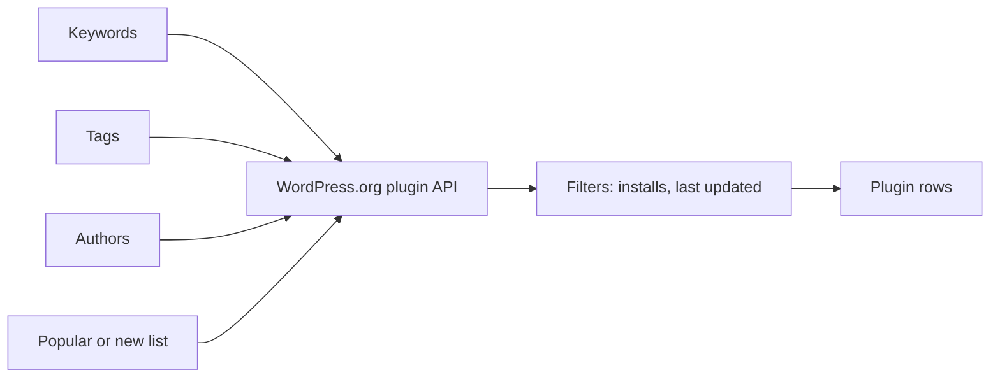

# WordPress Plugins Scraper: Active Installs, Ratings, Authors and Support Stats

[](https://apify.com/Turboextract/wordpress-plugins)
[](LICENSE)
[](#pricing)

**Export WordPress.org plugins by keyword, tag, author or directory list, with active installs, total downloads, rating, star breakdown, support threads, version, tested WordPress and PHP versions, last updated, added date, author and homepage.** Size a plugin niche, track competitors or build a list of plugin developers. No API key.

In one test, the search "booking" plus the popular list, filtered to 1,000+ installs, returned 120 plugins in about 5 seconds.

**Try it now →** [apify.com/Turboextract/wordpress-plugins](https://apify.com/Turboextract/wordpress-plugins)

---

## Why this exists

- WordPress.org shows plugins 20 at a time with no export.
- Installs, ratings and support stats sit on separate pages.
- WordPress market research tools charge $50+ a month.
- Agencies and plugin makers need the numbers in a spreadsheet.

---

## Who this is for

- **Plugin developers** sizing a niche and tracking competitors
- **WordPress agencies and hosts** choosing plugins and spotting abandoned ones
- **SaaS companies** finding plugin developers to partner with
- **Investors and acquirers** looking for plugins to buy
- **Security researchers** listing plugins by installs and update age

---

## What you get

```json
{
  "slug": "booking-package",
  "name": "Booking Package",
  "url": "https://wordpress.org/plugins/booking-package/",
  "activeInstalls": 10000,
  "downloaded": 1299524,
  "rating": 4,
  "numRatings": 15,
  "ratings": { "1": 3, "2": 1, "3": 0, "4": 0, "5": 11 },
  "supportThreads": 21,
  "supportThreadsResolved": 14,
  "version": "1.7.49",
  "testedUpTo": "7.1.5",
  "lastUpdated": "2026-11-23T14:04:00Z",
  "added": "2018-02-26",
  "tags": ["appointment", "booking", "booking calendar", "reservation"],
  "author": "MASAAKI TANAKA",
  "authorProfile": "https://profiles.wordpress.org/masaakitanaka/",
  "homepage": "https://saasproject.net/plans/"
}
```

---

## How it works



---

## Quick start

1. Click **Try for free**.
2. Add **Search keywords**, like `forms` or `booking`, or **Tags** like `ecommerce`.
3. Optional: add **Authors** or a **Directory list** like Popular or New.
4. Optional: set **Minimum active installs** or **Updated within days**.
5. Click **Start**, then export to CSV, JSON, Excel or Google Sheets.

### API

```bash
curl -X POST "https://api.apify.com/v2/acts/Turboextract~wordpress-plugins/run-sync-get-dataset-items?token=YOUR_TOKEN" \
  -H "Content-Type: application/json" \
  -d '{"tags": ["ecommerce"], "minInstalls": 10000, "maxResults": 500}'
```

### Python

```python
from apify_client import ApifyClient

client = ApifyClient("YOUR_TOKEN")
run = client.actor("Turboextract/wordpress-plugins").call(run_input={
    "searchQueries": ["seo"],
    "updatedWithinDays": 365,
})
for p in client.dataset(run["defaultDatasetId"]).iterate_items():
    print(p["name"], p["activeInstalls"], p["rating"], p["author"])
```

---

## Input fields

| Field | Default | What it does |
|---|---|---|
| `searchQueries` | – | Directory search keywords |
| `tags` | – | Plugin tags |
| `authors` | – | WordPress.org usernames |
| `browse` | none | Popular, new, updated or top rated list |
| `minInstalls` | 0 | Active installs floor |
| `updatedWithinDays` | 0 | Skip stale plugins |
| `maxResults` | 50 | Total cap per run |

---

## Pricing

**$0.001 per plugin delivered.** 1,000 plugins cost $1.

| Option | 1,000 plugins |
|---|---|
| **WordPress Plugins Scraper** | **$1** |
| WordPress market research tools | $50+ a month |

---

## Common use cases

- **Niche sizing**: total installs across every plugin for a keyword
- **Competitor tracking**: weekly installs, rating and version for rivals
- **Acquisition leads**: plugins with 10K+ installs not updated in a year
- **Partnerships**: plugin authors and homepages in your category
- **Security lists**: popular plugins by last update and tested version

---

## Tips for best results

- `activeInstalls` is WordPress.org's rounded bucket, like 10,000+.
- `rating` is out of 5. `ratingPercent` is the raw score out of 100.
- Low `supportThreadsResolved` against `supportThreads` can signal a struggling plugin.
- Tags use hyphens, like `contact-form`.

---

## Pairs well with

- [Firefox Add-ons Scraper](https://apify.com/Turboextract/firefox-addons): browser extensions with developer contacts
- [Chrome Extension Leads](https://apify.com/Turboextract/chrome-extension-leads): Chrome Web Store developer leads
- [Shopify Store Products](https://apify.com/Turboextract/shopify-store-products): products from Shopify stores

---

## FAQ

**Do I need a WordPress account?** No. The actor uses WordPress.org's public plugin API.

**Does it include premium plugins sold elsewhere?** No, only plugins in the WordPress.org directory.

**Are author emails included?** No. You get the author's profile page and plugin homepage.

**How fresh is the data?** It is read live on every run.

**Is it legal?** It uses the official, public WordPress.org API.

---

## SEO keywords

WordPress plugins scraper, WordPress plugin API export, WordPress plugin active installs, WordPress plugin market research, WordPress plugins to CSV, plugin developer leads, WordPress plugin directory data, abandoned WordPress plugins list, WordPress competitor tracking, WP plugin ratings

---

## Support

- Actor page: https://apify.com/Turboextract/wordpress-plugins
- Issues and questions: open an issue in this repo
- Community Discord: https://discord.gg/8SrXSCpvgj

Built and maintained by [Turboextract](https://apify.com/Turboextract) on the Apify platform.

---

## License

The documentation and examples in this repository are MIT licensed. The actor itself runs on the Apify platform.
